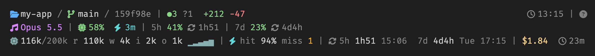

# Glance

A status line for [Claude Code](https://code.claude.com) that shows your repo, your context window and your usage limits at a glance, with token, cache and cost detail when you want it.



- **Row 1, the repo:** folder, branch and `HEAD` (⌘-click opens the PR or commit on GitHub), ahead/behind, staged, modified, untracked and stashed counts, and the lines Claude changed this session. A clock and a `?` link to the cheat sheet sit on the right.
- **Row 2, Claude at a glance:** the model, context used, how long the prompt cache stays warm, and the 5-hour and 7-day limits with the time until each resets. Colours go from green to amber at 60% and red at 85%.
- **Row 3, the detail (off by default):** tokens in the context and the last request's cache split, a sparkline of context over the session, cache hit rate and misses, reset clock times, session cost and time.

Each row drops its least useful parts first when the terminal is narrow. Until a session's first reply, when Claude Code has no numbers yet, row 2 shows the last known ones in grey.

The `?` icon opens a cheat sheet that explains every symbol.

## Install

In Claude Code:

```
/plugin marketplace add MikaelJohnAndersson/glance-statusline
/plugin install glance@glance-statusline
/glance:setup
```

Or from your shell, then run `/glance:setup` in a session:

```
claude plugin marketplace add MikaelJohnAndersson/glance-statusline
claude plugin install glance@glance-statusline
```

`/glance:setup` points the `statusLine` setting in your user settings at the plugin. If you already have a status line it asks before replacing it, and it backs up your settings first.

## Requirements

- A [Nerd Font](https://www.nerdfonts.com) in your terminal, for the icons. Without one they show as boxes. The status line uses whatever font your terminal does; a "Mono" variant, such as FiraCode Nerd Font Mono, keeps every icon to one cell, so the gaps after icons are even.
- `jq`, `git` and `bash`. Works on macOS and Linux.
- A Claude Pro or Max plan for the usage limits; the rest works on any plan.

## Commands

| Command | What it does |
| --- | --- |
| `/glance:setup` | Turns the status line on |
| `/glance:detail` | Shows or hides the third row |
| `/glance:remove` | Turns the status line off, before you uninstall |

## How it works

Claude Code can't set a status line from a plugin, so `/glance:setup` writes one entry in your settings. It points at a copy of the script in the plugin's data folder (`~/.claude/plugins/data/glance-glance-statusline/`), which survives updates; every session start refreshes that copy, so updates reach you without running setup again. The context history, last known limits and the detail toggle live in the same folder.

To get updates, run `claude plugin update glance@glance-statusline`, or turn on auto-update for the marketplace in `/plugin`.

## License

[MIT](LICENSE)
